# Media Converter

A self-hosted media toolkit with a bounded processing queue and hardware-aware encoding.

<p align="center">
  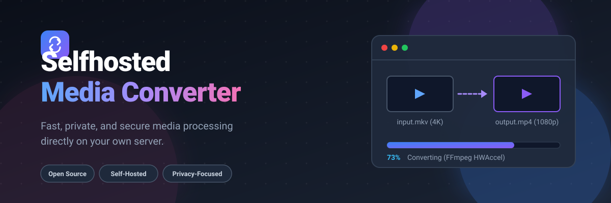
</p>

<p align="center">
  Self-hosted media processing platform for downloading, converting, transcribing and managing audio, video and image files.
</p>

<p align="center">
  
  
  
  
  
  
</p>

---

## Screenshots

<p align="center">
  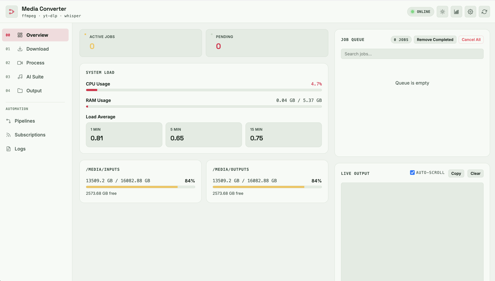
</p>

<br>

<p align="center">
  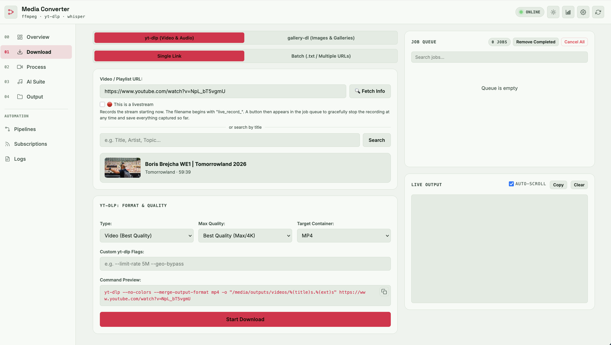
</p>

<br>

<p align="center">
  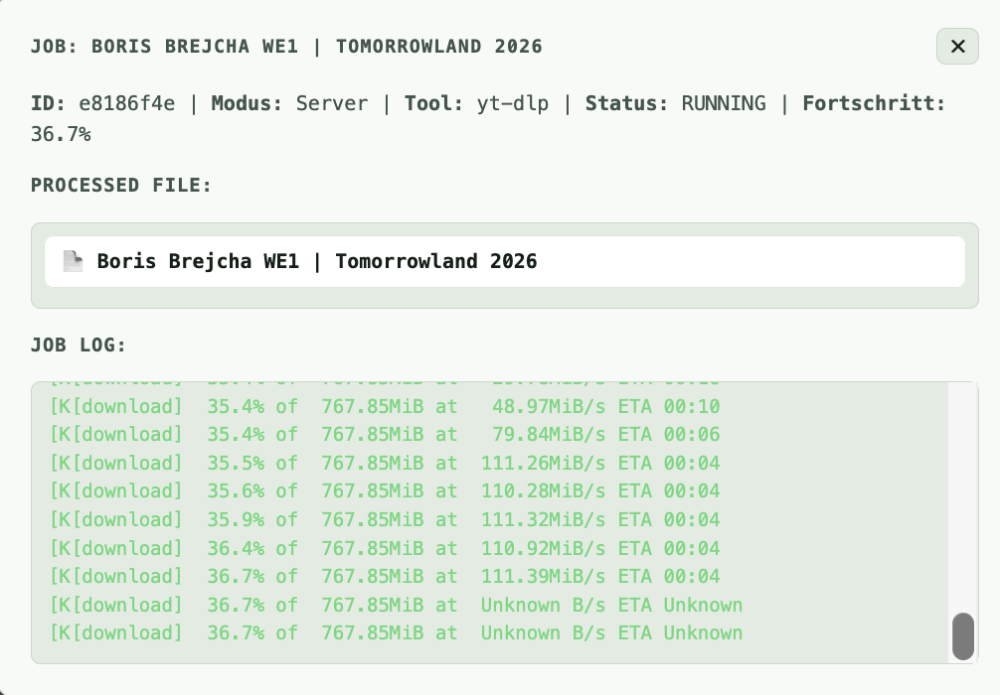
</p>

<br>

<p align="center">
  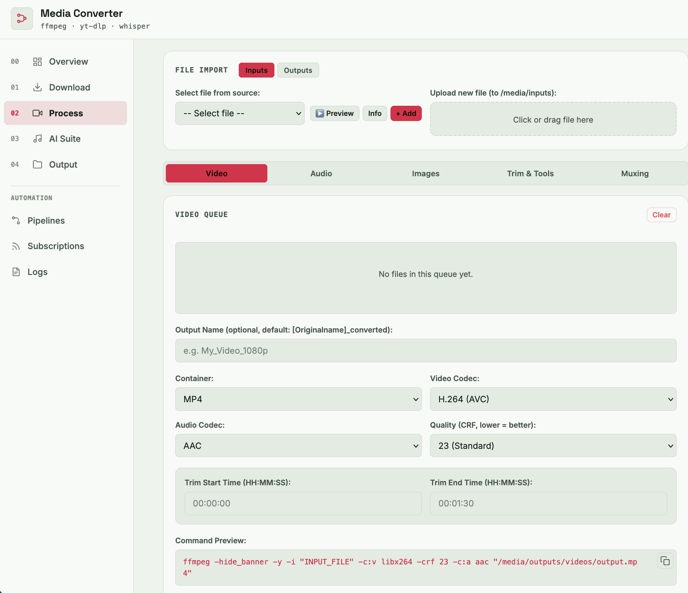
</p>

<br>

<p align="center">
  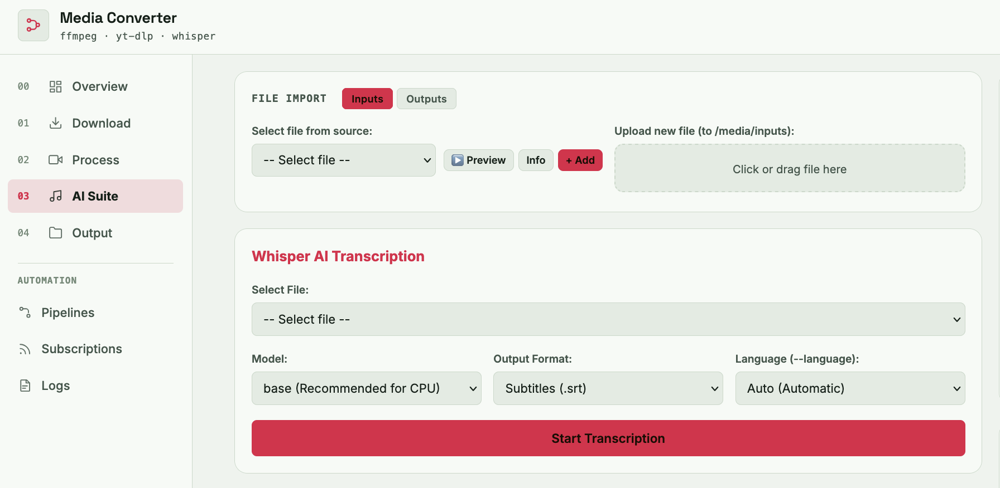
</p>

<br>

<p align="center">
  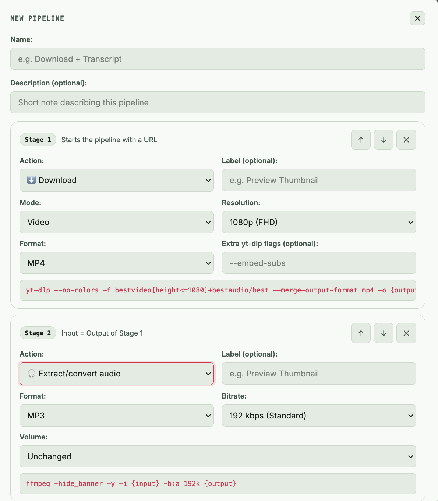
</p>

<br>

<p align="center">
  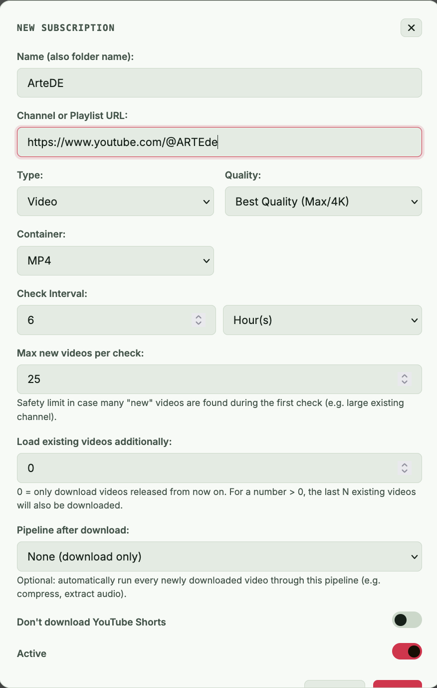
</p>

<br>

<p align="center">
  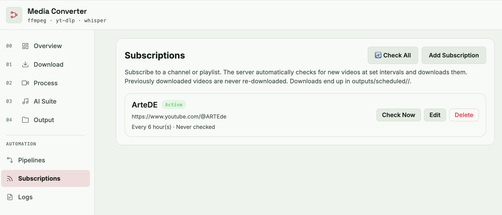
</p>

<br>

<p align="center">
  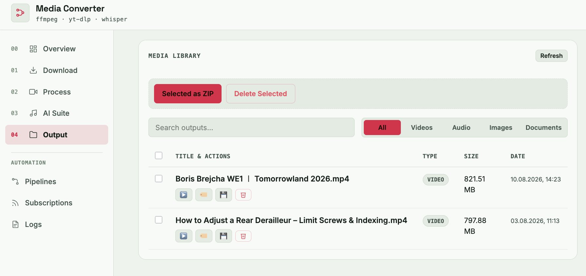
</p>

<br>

<p align="center">
  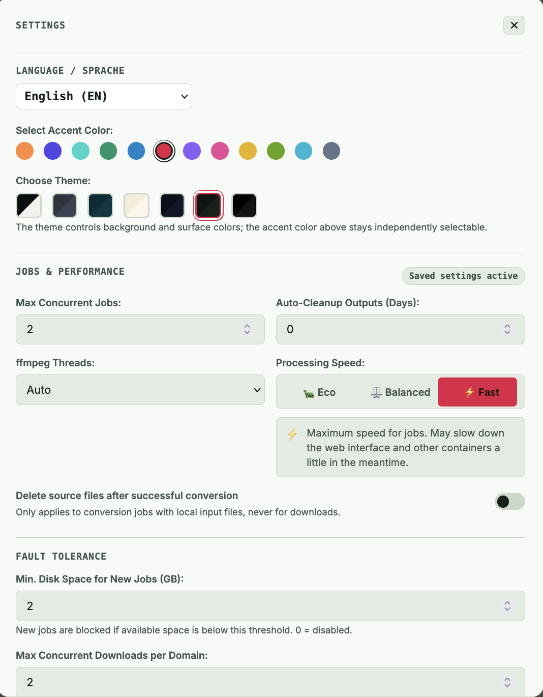
</p>

---

## Overview

Media Converter is a self-hosted media toolkit for downloading, converting, transcribing and processing multimedia files.

The application combines **yt-dlp**, **gallery-dl**, **FFmpeg** and **OpenAI Whisper** with a modern web interface, background job processing, live logs and system monitoring.

Designed to run locally or on a private server using Docker.

---

## Features

### Media Download

- Download videos, audio and playlists using **yt-dlp**
- Download image galleries using **gallery-dl**
- Support for multiple media sources, including cookie-based authentication
- Background processing queue with per-domain and global concurrency limits
- Job history tracking
- Bulk ZIP downloads
- Download Livestreams from e.g. YouTube

### Video Conversion

- Convert videos between:
  - MP4
  - MKV
  - WEBM
  - GIF

- Encoding support:
  - H.264
  - H.265
  - AV1

Additional processing:

- Thumbnail extraction
- Frame extraction
- Audio/video muxing
- Playback speed adjustment

### Audio Processing

- Extract audio tracks from videos
- Convert audio formats:
  - MP3
  - M4A
  - WAV
  - FLAC

### AI Transcription

Powered by **OpenAI Whisper**.

Supported models:

- tiny
- base
- small
- medium
- large-v3

Generated outputs:

- Subtitle files (`.srt`)
- Text transcripts (`.txt`)

### Image Processing

Convert images between:

- JPG
- PNG
- WEBP

### Automation & Notifications

- Reusable processing pipelines
- Subscriptions for automatically fetching new content from a source
- Optional push notifications via Pushover
- Optional automatic cleanup of old files

### Also

- Start/Pause Downloads or Tasks
- Add cookies from YouTube
- Save custom settings
- Language: German & English

---

## Quick Start

### Requirements

Before installing, make sure the following are available:

- Docker
- Docker Compose

### Installation

Clone the repository:

```bash
git clone https://github.com/Frxhb/selfhosted-media-converter.git

cd selfhosted-media-converter
```

### Configuration

Create an environment file (even an empty one works, since every setting has a sane default):

```bash
touch .env
```

Then edit `docker-compose.yml` according to your environment — most commonly:

- exposed port
- mounted directories
- timezone (`TZ`)
- container name

Optional settings can be placed in `.env` and are picked up automatically. The most relevant ones:

| Variable | Default | Description |
|----------|---------|-------------|
| `MAX_CONCURRENT_JOBS` | `2` | Maximum parallel jobs (1–8); UI changes apply immediately |
| `MAX_CONCURRENT_PER_DOMAIN` | `2` | Maximum parallel downloads per source domain |
| `MAX_CONCURRENT_WHISPER_JOBS` | `1` | Maximum parallel transcription jobs |
| `FFMPEG_THREADS` | `Auto` | Per-job CPU budget: available CPUs / configured parallel jobs; explicit thread counts override it |
| `DEFAULT_PRIORITY` | `below_normal` | Default OS process priority for jobs |
| `MIN_FREE_DISK_GB` | `2.0` | Minimum free disk space before new jobs are accepted |
| `AUTO_DELETE_ORIGINALS` | `false` | Delete source files after successful processing |
| `AUTO_CLEANUP_DAYS` | `0` | Auto-delete outputs older than N days (`0` disables it) |
| `LOG_LEVEL` | `INFO` | Application log level |
| `PUSHOVER_ENABLED` | `false` | Enable Pushover push notifications |

Most of these can also be changed later from the web UI's settings page.

Default directory structure (created automatically on first start):

```text
media/
├── inputs/
└── outputs/

config/
```

### Start Application

Build and start the container:

```bash
docker compose up --build -d
```

The web interface will be available at:

```text
http://<server-ip>:8080
```

---

## Media Studio interface

The overview shows recent outputs with download and processing actions, and existing
source files that can be added directly to a conversion queue. File selection and
drag-and-drop accept multiple uploads, processed sequentially with aggregate progress
and cancellation. Successful uploads remain available after cancellation or partial
failure. Duplicate upload names get a numeric suffix instead of overwriting files.
The responsive layout keeps the job queue alongside the workspace on desktop;
technical logs and codec details can be expanded when needed.

The video converter includes four result-oriented presets:

| Preset | Output |
|--------|--------|
| Play everywhere | H.264 / AAC in MP4, up to 1080p |
| Save storage | H.265 (H.264 fallback) in MP4, up to 720p |
| Ready for the web | VP9 (AV1 fallback) / Opus in WebM, up to 1080p |
| Keep full quality | Copy video/audio into MKV without re-encoding |

You can limit the resolution without upscaling, select a frame rate, remove audio
and set a trim range. Resolution and frame-rate changes require re-encoding; Stream
Copy combinations are checked before submission. The job summary shows the selected
result before you start. A personal preset can be saved in this browser and loaded
again; source paths, output names and trim ranges are not stored in that preset.
Files stay selected when the server rejects a job, so you can correct it and retry.


## Hardware and resource tuning

Open **Settings → Hardware & encoding** to see the platform, available CPU budget,
RAM and tested GPU encoders. `/api/system/hardware` exposes the same diagnostics,
including reasons why compiled hardware encoders failed their test. Detection is
cached until the application restarts. Software encoders are checked against the
FFmpeg build; GPU candidates additionally encode one synthetic frame.

The video converter offers CPU encoders plus usable NVIDIA NVENC, Intel QSV,
Intel/AMD VAAPI and native macOS VideoToolbox encoders. A successful probe does not
guarantee support for every source resolution, pixel format or driver combination.
There is no silent switch to CPU when a GPU job fails. Existing pipeline stages keep
their explicit codec settings; GPU selection is available in the video converter.
VAAPI currently uses the first `/dev/dri/renderD*` device.

- **Small NAS / Raspberry Pi:** start with one parallel job and Auto threads. Stream
  Copy avoids re-encoding when the original streams fit the destination container.
- **CPU server:** Auto shares CPU affinity and cgroup v1/v2 quotas across the
  configured parallel jobs. Explicit thread settings override the budget. Decoder,
  encoder, filter, x265 and SVT-AV1 pools receive limits where supported; these are
  thread budgets, not a hard OS CPU limit.
- **Intel/AMD on Linux:** pass the render device into the container:

  ```bash
  docker compose -f docker-compose.yml -f docker-compose.gpu-intel.yml up --build -d
  ```

  The container user must have access to the render device. The installed FFmpeg
  build and userspace drivers must support the selected GPU; passing a device alone
  does not install drivers. The capability test reports failures.
- **NVIDIA on Linux:** install NVIDIA Container Toolkit on the host, then:

  ```bash
  docker compose -f docker-compose.yml -f docker-compose.gpu-nvidia.yml up --build -d
  ```

  See [Docker's GPU setup](https://docs.docker.com/compose/how-tos/gpu-support/).
  FFmpeg's NVENC support and the host driver must be compatible. For CUDA Whisper,
  also rebuild with a suitable `TORCH_VARIANT` build argument.
- **Apple Silicon:** VideoToolbox requires a native macOS FFmpeg installation.
  Docker Desktop runs Linux containers and does not expose Apple's VideoToolbox.

Quality numbers have different meanings across encoders. The UI translates its
quality selection to CRF, CQ, QP, global quality or VideoToolbox quality. Compare
short samples for visual quality and file size before large batches.
WebM selection filters video codecs to VP9/AV1 and uses Opus by default; GIF has no
audio. MP4 output uses `+faststart` for earlier playback over HTTP. Stream Copy
still requires source streams that are compatible with the chosen container.

### Smaller image without transcription

Whisper/PyTorch remains enabled by default. If you only download and convert,
build without the AI dependencies:

```bash
docker compose build --build-arg INSTALL_WHISPER=false
docker compose up -d
```

The transcription UI remains present, but starting a Whisper job reports the
missing tool. Install `requirements-ai.txt` instead of `requirements.txt` for a
native installation that needs transcription.

### Development checks

```bash
python -m pip install -r requirements-test.txt
python -m unittest discover -s tests -v
node tests/test_video_options.cjs
node tests/test_studio.cjs
node tests/test_upload_batch.cjs
```

Tests cover queue admission, live concurrency changes, cancellation, request
validation, subprocess cleanup, SQLite WAL backups and real FFmpeg conversions.
GitHub Actions runs the checks on Python 3.11 and 3.14. Docker images and GPU
encoders also need validation on the target hardware.


## Updating

Pull the latest changes:

```bash
git pull
```

Rebuild the application:

```bash
docker compose up --build -d
```

To completely recreate the environment:

```bash
docker compose down

docker compose up --build -d
```

---

## Directory Structure

| Directory | Description |
|-----------|-------------|
| `media/inputs` | Source files available for processing |
| `media/outputs` | Generated output files |
| `config` | Application configuration and SQLite database |
| `config/logs` | Application logs (rotated automatically) |

---

## Architecture

```text
                     Browser
                        |
                        v
                 FastAPI Web UI
                        |
        +---------------+---------------+---------------+
        |               |               |               |
        v               v               v               v
   Job Queue        FFmpeg          yt-dlp          gallery-dl
        |
        v
 Whisper Transcription
```

---

## Tech Stack

| Component | Technology |
|-----------|------------|
| Backend | FastAPI |
| Media Processing | FFmpeg |
| Video/Playlist Downloads | yt-dlp |
| Gallery/Image Downloads | gallery-dl |
| AI Transcription | OpenAI Whisper |
| Database | SQLite |
| Containerisation | Docker |
| Communication | WebSockets |

---

## Roadmap

Further improvements:

- User authentication and authorization
- Automatic Whisper device/model selection based on available RAM/VRAM
- Additional media providers
- Cloud storage integrations
- Extended monitoring features

---

## Contributing

Contributions, bug reports and feature requests are welcome.

Please open an issue or submit a pull request.

---

## License

This project is licensed under the MIT License.
